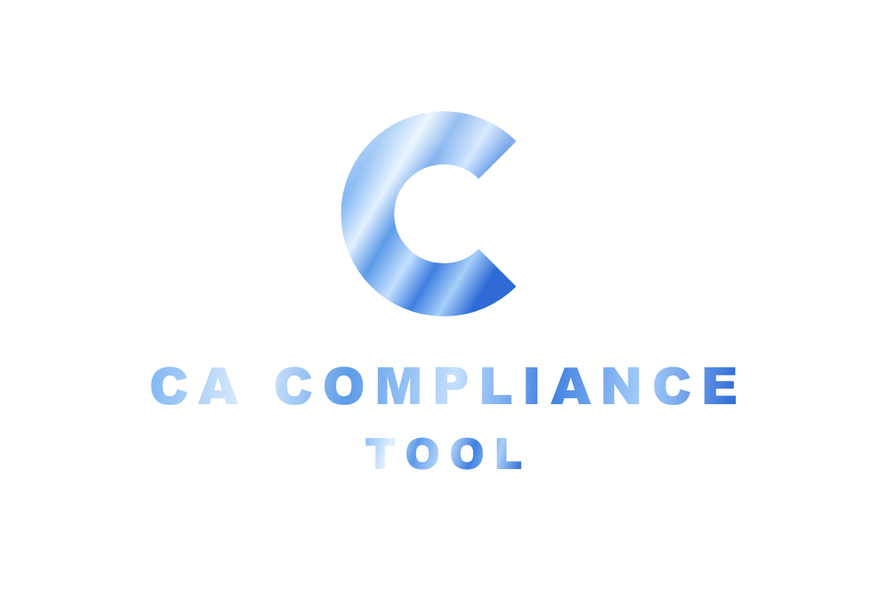

<p align="center">
  
</p>

<h1 align="center">CA Compliance Tool</h1>

<p align="center">
  <strong>Live: <a href="https://cacompliancetool.com">cacompliancetool.com</a></strong>
</p>

CA Compliance Tool is a compliance tracker for companies registered under India's Companies Act, 2013. It's built for CAs, CSs and anyone who handles company filings. You keep every client company's due dates, directors and filings in one place, so you don't have to track them in Excel sheets.

## Features

- **Dashboard:** shows every overdue and upcoming filing across all your companies (AOC-4, MGT-7/7A, ADT-1, DPT-3, INC-20A, DIR-3 KYC, ITR and more), with a compliance calendar beside it.
- **Due dates worked out for you:** each company's dates are calculated from its own incorporation date, AGM, financial year and auditor details.
- **Import from MCA master data:** upload the MCA master data PDF or Excel and the company details (CIN, capital, registered office, email) and directors fill in automatically. It also reads scanned or "Print to PDF" files using in-browser OCR. Uploading several files at once works, and companies already added are skipped.
- **Challan upload:** upload MCA challans or ITR acknowledgements and the tool reads the SRN or acknowledgement number, matches the company and form, and marks the filing as filed. It handles batches, warns about duplicates and lets you choose first or subsequent auditor for ADT-1.
- **Director Master and Consultant Master:** directors (with DIN per company), KYC status and consultants across all companies, with PDF and Excel reports.
- **Document Generator:** board and general meeting notices, resolutions and other documents on the company's letterhead.
- **Bank statement to Excel:** converts bank statement PDFs into spreadsheets.
- **Reference:** forms, sections, applicability checks, incorporation and checklists.
- **Accounts and data:** sign in with Clerk. Your data is saved privately to your account, so you see it on any device. You can export and import it as JSON.

## Privacy

Uploaded PDFs and Excel files are read in your browser. They aren't sent to an AI service or a third-party API, and no other user can see your client data.

## Built with

- Next.js 16 (App Router) and React 19, written in JavaScript
- Tailwind CSS v4 and shadcn/ui
- Clerk for authentication
- pdf.js, Tesseract.js (OCR) and read-excel-file for in-browser document reading
- Vercel for hosting, with Vercel Blob for private storage

## Running locally

```bash
npm install
npm run dev      # http://localhost:3000
npm test         # unit tests
npm run build    # production build
```

Create a `.env.local` with your Clerk keys (`NEXT_PUBLIC_CLERK_PUBLISHABLE_KEY`, `CLERK_SECRET_KEY`) and `BLOB_READ_WRITE_TOKEN` for Vercel Blob.

## Disclaimer

CA Compliance Tool is a reference tool for general information only and is not legal or professional advice. Always check due dates and requirements against the Companies Act, the Rules and the official MCA portal.

© 2026 CA Compliance Tool. All rights reserved.
